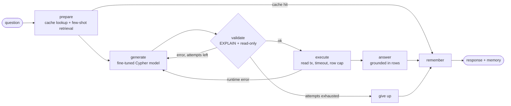

# text2cypher-agent

[](https://github.com/Alby-Rajesh/text2cypher-agent/actions/workflows/ci.yml)


Ask questions about a Neo4j graph in plain English. A **QLoRA fine-tuned small model** writes the Cypher, a **LangGraph** agent validates and self-corrects it against the live schema, and the answer comes back grounded in the query results, with **Redis** caching and conversation memory and **LangSmith** tracing and evaluation.

```text
> Who acted in The Matrix?
MATCH (p:Person)-[:ACTED_IN]->(m:Movie {title: 'The Matrix'}) RETURN p.name AS name

> Which of them also directed a movie?
MATCH (p:Person)-[:ACTED_IN]->(:Movie {title: 'The Matrix'}) MATCH (p)-[:DIRECTED]->(d:Movie) RETURN p.name, d.title
```

The second question only works because the agent remembers the first.

## Architecture



| Concern | Approach |
|---|---|
| **Cypher generation** | Qwen2.5-Coder-3B fine-tuned with QLoRA on the [Neo4j Text2Cypher (2024)](https://huggingface.co/datasets/neo4j/text2cypher-2024v1) dataset, served as a LoRA adapter on vLLM. Any OpenAI-compatible model can be swapped in. |
| **One prompt, two uses** | Training data is built with the same `cypher_messages()` function the agent uses at inference, so the fine-tuned model sees exactly the production prompt format. |
| **Validation** | Every query goes through `EXPLAIN` first. Syntax and schema errors come back as text, and the plan's query type rejects anything that would write. |
| **Self-correction** | Failed queries are sent back to the model with the error as a follow-up turn, up to a configurable number of attempts. |
| **Few-shot retrieval** | BM25 over the dataset's training questions for the connected database picks the most similar examples per question. |
| **Safe execution** | Read transactions only, a per-query timeout and a row cap. |
| **Memory** | LangGraph checkpoints in Redis (`RedisSaver`, with TTL) keyed by `thread_id`, so follow-up questions resolve against earlier turns. |
| **Caching** | Standalone questions are cached in Redis by normalized text; follow-ups are never cached because their meaning depends on context. Cache failures degrade to a miss. |
| **Observability** | LangSmith traces every graph run, including the validate and execute tools; evaluation results can be logged as LangSmith experiments. |
| **Evaluation** | Execution accuracy against gold queries on the live database (column-name-agnostic, order-aware when the gold query sorts), plus first-try accuracy, valid-query rate, exact match, attempts and latency. |

## Quickstart

Requirements: Python 3.11+, an OpenAI-compatible model endpoint, Redis 8 (for memory) or no Redis at all.

```bash
git clone https://github.com/Alby-Rajesh/text2cypher-agent.git
cd text2cypher-agent
pip install -e ".[dev,data]"
cp .env.example .env
text2cypher examples
text2cypher chat
```

By default the agent connects to the public, read-only **movies** database at `neo4j+s://demo.neo4jlabs.com`. Point `T2C_NEO4J__*` at any other database; the schema is read automatically. The demo server also hosts `recommendations`, `companies`, `stackoverflow`, `twitter` and others, each using its name as username and password.

### Docker

```bash
docker compose up --build
docker compose --profile gpu up --build
```

The first command starts Redis and the API. The second also starts vLLM serving the base model with the fine-tuned adapter.

### API

```bash
curl -s localhost:8080/v1/query -H 'content-type: application/json' \
  -d '{"question": "Which movies did Tom Hanks act in after 2000?", "thread_id": "demo"}'
```

Returns the answer, the Cypher, the result rows, the number of attempts and whether it came from cache. Reusing a `thread_id` continues the conversation.

## Fine-tuning

| | |
|---|---|
| Base model | `Qwen/Qwen2.5-Coder-3B-Instruct` (7B works with the same config on a larger GPU) |
| Method | QLoRA: 4-bit NF4 base, LoRA r=16 on all attention and MLP projections |
| Data | 12k de-duplicated training pairs, schemas up to 6k characters, prompt-completion format with loss on the Cypher only |
| Trainer | TRL `SFTTrainer`, cosine schedule, gradient checkpointing, fp16 for T4 GPUs |
| Hardware | Fits a free Kaggle T4 |

```bash
pip install -e ".[finetune]"
python finetune/prepare.py
python finetune/train.py
```

Or open [`finetune/kaggle_train.ipynb`](finetune/kaggle_train.ipynb) on Kaggle with a T4 GPU and an `HF_TOKEN` secret. It runs a short smoke test, trains, and pushes the adapter to the Hugging Face Hub. Set `hub.model_id` in [`finetune/config.yaml`](finetune/config.yaml) to your own Hub namespace first.

Serve the adapter next to the base model:

```bash
vllm serve Qwen/Qwen2.5-Coder-3B-Instruct --enable-lora \
  --lora-modules text2cypher=<your-hub-namespace>/text2cypher-qwen2.5-coder-3b-lora --max-lora-rank 16
```

## Evaluation

```bash
text2cypher evaluate --limit 200
text2cypher evaluate --limit 200 --langsmith
```

Questions come from the dataset's **test** split for the connected database; few-shot examples come only from the **train** split. Both the gold and the generated queries run against the live database and their results are compared. Results are written to `output/eval/<model>/`.

| Cypher model | Questions | Execution accuracy | Valid queries | Exact match | p50 latency |
|---|---|---|---|---|---|
| Qwen3.8-27B, 4-shot (Groq) | 100 | **60%** | 95% | 9% | 3.7 s |
| Base Qwen2.5-Coder-3B | | run `evaluate` with `T2C_LLM__CYPHER_MODEL=Qwen/Qwen2.5-Coder-3B-Instruct` | | | |
| Fine-tuned 3B adapter | | run `evaluate` with `T2C_LLM__CYPHER_MODEL=text2cypher` | | | |

Measured on the first 100 `movies` test questions against a local Neo4j 5.26 loaded with the standard movies graph (`T2C_NEO4J__DATABASE=neo4j`, `T2C_NEO4J__DATASET=movies`). That graph has no `Movie.votes` property, so about 15% of gold queries return empty results there; a prediction only counts as correct when its rows match the gold rows exactly. Exact match is low by design: many different queries return the same rows, which is why execution accuracy is the headline metric.

## Configuration

All settings come from environment variables (or `.env`) with the `T2C_` prefix and `__` for nesting. See [`settings.py`](src/text2cypher/settings.py) for every option.

| Variable | Default | Purpose |
|---|---|---|
| `T2C_LLM__BASE_URL` | `http://localhost:8000/v1` | OpenAI-compatible endpoint (vLLM, OpenAI, Groq …) |
| `T2C_LLM__CYPHER_MODEL` | `text2cypher` | model or LoRA adapter that writes Cypher |
| `T2C_LLM__ANSWER_MODEL` | `Qwen/Qwen2.5-Coder-3B-Instruct` | model that phrases the answer |
| `T2C_NEO4J__*` | public movies demo | connection, query timeout, row limit; `DATASET` picks the benchmark split when the database name differs (e.g. a local copy of movies) |
| `T2C_REDIS__URL` | `redis://localhost:6379/0` | cache and memory; empty disables Redis |
| `T2C_AGENT__MAX_ATTEMPTS` | `3` | generate → validate → correct loop limit |
| `T2C_AGENT__FEW_SHOT_K` | `4` | retrieved examples per question |
| `T2C_LANGSMITH__API_KEY` | – | turns on LangSmith tracing |

Prompts live in [`configs/prompts.yaml`](configs/prompts.yaml).

## Project structure

```
src/text2cypher/
├── agent.py        LangGraph state machine: prepare → generate → validate → execute → answer
├── graphdb.py      Neo4j schema introspection, EXPLAIN validation, safe read execution
├── prompts.py      prompt builders shared by inference and fine-tuning
├── examples.py     BM25 few-shot retrieval and dataset loading
├── cache.py        Redis query cache
├── service.py      wiring: models, Redis checkpointer, dependencies
├── evaluation.py   execution-accuracy harness and LangSmith experiments
├── api.py          FastAPI service
└── cli.py          chat, ask, serve, examples, evaluate
finetune/           data prep, QLoRA training, Kaggle notebook
tests/              agent graph, validation, cache, evaluation and API tests with fake models
```

## Testing

```bash
make lint
make test
```

Tests use fake chat models and a fake graph, so they run without a GPU, Neo4j or Redis. They cover self-correction, retry limits, caching, conversation memory, read-only enforcement, result comparison and the API.

## License

MIT
